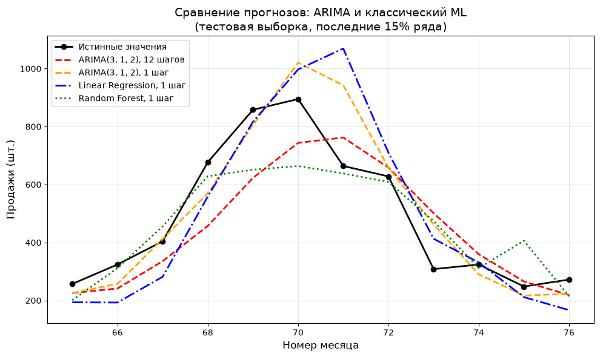

# Анализ и прогнозирование временных рядов

Стационарность, экспоненциальное сглаживание, ARIMA против ML, GARCH и сингулярный спектральный анализ (SSA) на классических рядах и данных акселерометра.

## Задача

Отработать полный классический инструментарий анализа временных рядов: проверить и обеспечить стационарность, построить простые и сезонные модели сглаживания, подобрать ARIMA и честно сравнить её с ML-моделями на отложенной выборке, проверить наличие кластеров волатильности и описать их моделью GARCH, разложить периодический сенсорный сигнал методом SSA. Акцент — на корректной валидации прогнозов и интерпретации результатов, а не только на подборе моделей.

## Данные

- 6 классических рядов из Time Series Data Library (авиапассажиры, температура, ограбления в Бостоне, продажи компании X, рождаемость, Dow Jones) — от 77 до 365 наблюдений, общедоступные учебные датасеты.
- Один файл из [MotionSense](https://github.com/mmalekzadeh/motion-sense) (лицензия MIT): бег, участник 21, 50 Гц, около 5.5 тыс. строк.

Все файлы небольшие и лежат в [`data/`](data/); описание и атрибуция — в [`data/README.md`](data/README.md).

## Подход

| Ноутбук | Содержание |
|---|---|
| [`01_stationarity`](notebooks/01_stationarity.ipynb) | ADF-тест для 6 рядов; log, `diff(1)`, `diff(12)`; сравнение вариантов преобразований |
| [`02_smoothing`](notebooks/02_smoothing.ipynb) | MA, EMA, DEMA (Хольт), TEMA (Хольт–Винтерс) «с нуля»; подбор параметров на валидации (rolling origin, 3 окна по 5 точек), отложенный тест 5 точек |
| [`03_arima_vs_ml`](notebooks/03_arima_vs_ml.ipynb) | ARIMA с перебором (p, d, q) по AIC; сравнение с LinearRegression и RandomForest на лагах 1–24 и с сезонным наивным прогнозом на последних 15% ряда |
| [`04_garch`](notebooks/04_garch.ipynb) | ARIMA по AIC, тест Льюнга–Бокса на квадратах остатков, GJR-GARCH с t-распределением, проверка стандартизованных остатков |
| [`05_ssa`](notebooks/05_ssa.ipynb) | Собственная реализация SSA (траекторная матрица, SVD, диагональное усреднение, w-корреляции); сравнение L = 50/150/300, интерпретация компонент |

## Результаты

**ARIMA против ML** (продажи компании X, тест — последние 12 месяцев, исходные единицы):

| Модель | MAE | RMSE |
|---|---|---|
| ARIMA(3,1,2), прогноз на 12 шагов | 101.46 | 126.27 |
| ARIMA(3,1,2), 1 шаг вперёд | **80.77** | **108.97** |
| Linear Regression, лаги 1–24 (1 шаг) | 110.03 | 146.33 |
| Random Forest, лаги 1–24 (1 шаг) | 87.16 | 116.04 |
| Сезонный наивный (t−12) | 95.42 | 112.09 |

В первой версии работы ARIMA обучалась на всём ряде, а её прогноз *за концом* ряда сравнивался с последними 15% *внутри* ряда; это давало заниженные MAE 52.60 / RMSE 63.65. После исправления ARIMA обучается только на train, а ML-модели сравниваются с ней на тех же 12 точках.



**Сглаживание** (MAE на отложенных 5 точках, параметры выбраны на валидации):

| Модель | Авиапассажиры | Температура |
|---|---|---|
| MA | 53.15 | 6.97 |
| EMA | 59.87 | 7.74 |
| DEMA | 215.22 | 7.83 |
| TEMA (Хольт–Винтерс) | **7.60** | **1.67** |

При подборе параметров прямо на тесте (как в первой версии) DEMA для пассажиров показывала бы MAE 58.42, а TEMA для температуры — 1.42; эти оценки оптимистичны.

**Стационарность:** ряд пассажиров стал стационарным после log + `diff(1)` + `diff(12)` (p-value ADF 0.0002); продажам, ограблениям и Dow Jones хватает log + `diff(1)`; температура и рождаемость стационарны по ADF без преобразований.

**GARCH** (ограбления в Бостоне): GJR-GARCH(0,1,2) — beta[1] = 0.95, асимметрия gamma[1] = 0.10 (p-value 0.048); в квадратах стандартизованных остатков автокорреляции нет (Льюнг–Бокс, p-value 0.31 / 0.46 на лагах 10 / 20).

**SSA:** период шага — 0.37 с (по FFT и паре компонент 1–2), также выделяются двойной шаг 0.75 с и гармоники 0.15–0.19 с; при L = 300 w-корреляционная матрица имеет чистую блочную структуру из пар компонент, первые 12 компонент дают 85.7% суммы собственных значений.

## Выводы

- Честная схема валидации меняет картину: исправленная оценка ARIMA в 1.5–2 раза хуже ошибочной, а подбор параметров на тесте скрывает провал DEMA на сезонном спаде.
- На коротком сезонном ряде ARIMA в режиме «1 шаг вперёд» немного лучше Random Forest и сезонного наивного прогноза, но при 12 тестовых точках это преимущество ненадёжно; прогноз ARIMA на 12 шагов хуже сезонного бейзлайна — нужна сезонная модель (SARIMA).
- Для месячных рядов с сезонностью из элементарных методов работает только Хольт–Винтерс (TEMA).
- ARCH-эффект в ряде ограблений пограничный и зависит от модели среднего (значим для ARIMA(0,1,2), незначим для ARIMA(3,1,3) с дрейфом); GJR-GARCH снимает остаточную гетероскедастичность, но оценки неустойчивы (gamma/2 + beta ≈ 1).
- В SSA длина окна определяет разделимость гармоник: при L = 50 высокие компоненты смешиваются, при L = 300 разделяются на чистые пары.

## Ограничения и что можно улучшить

- Ряды короткие (77–365 точек), тестовые отрезки 5–12 точек — различия между моделями статистически ненадёжны; стоит использовать rolling-origin кросс-валидацию везде, а не только в ноутбуке 02.
- ARIMA подбирается с d до 4 и сравнением AIC между разными d, что формально некорректно (разное число наблюдений); лучше фиксировать d по тестам ADF/KPSS. Нет SARIMA и моделей с экзогенными признаками.
- В ноутбуке 04 `pmdarima` недоступен для используемого окружения (Python 3.13), поэтому stepwise `auto_arima` заменён полным перебором по AIC через statsmodels; он выбрал другую модель (ARIMA(3,1,3) с дрейфом вместо ARIMA(0,1,2)).
- GARCH оценивается на 117 разностях — мало для надёжной оценки параметров волатильности; не сравнивались альтернативы (GARCH(1,1), EGARCH) по информационным критериям.
- В SSA группировка и выбор L сделаны визуально, на одном участнике и одном 15-секундном отрезке.

## Стек

Python 3.13, pandas, NumPy, statsmodels (ADF, ARIMA, Ljung–Box), arch (GARCH), scikit-learn, Matplotlib, Jupyter.

## Как запустить

```bash
pip install -r requirements.txt
cd notebooks
jupyter notebook
```

Данные уже лежат в `data/`, ноутбуки читают их по относительным путям `../data/...`. Ноутбуки независимы, их можно запускать в любом порядке. Выходы получены в окружении: Python 3.13, pandas 3.0, NumPy 2.5, statsmodels 0.15, arch 9.0, scikit-learn 1.9.

_Проект выполнен в рамках обучения по программе Data Science (Нетология, 2025–2027)._
